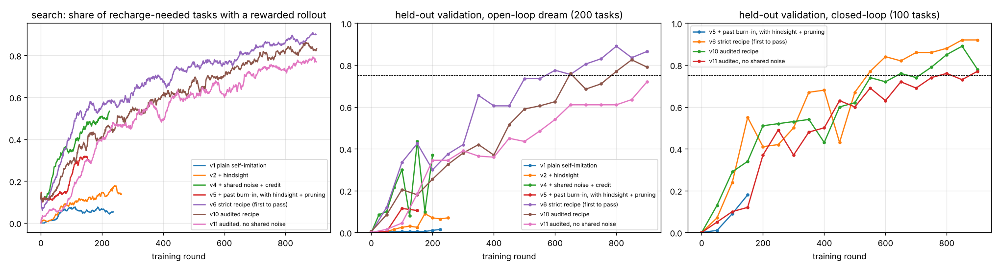

# Growing coupled worldlines: a space-time NCA that learns drone rendezvous from sparse reward

A neural cellular automaton grows, in a (t, x, y) lattice, the worldlines ("tubes") of two
drones that have to cooperate: a **seeker** that must reach a target but runs out of battery
on the way, and a **recharger** drone that has to come and meet it. Everything is learned from
a simulator and its sparse 0/1 reward. No solver, no dynamic programming, no distance
features, no shaped reward, no demonstrations, and the battery is never shown to the network.

**Result.** The audited run (v10, 900 training rounds, about 2.3 hours on 2 CPU threads) solves
**164 of 200 held-out recharge-needed tasks (82.0%)** with the closed-loop readout and 158 of 200
(79.0%) with the open-loop dream, so the stated bar of 75% on 200 held-out tasks is cleared. That
test set turned out to be an easy draw: on 2,000 further tasks that were never posed during training
the same checkpoint reaches **75.4% closed-loop** (95% interval 73.4-77.2) and 73.4% open-loop. An
earlier run of the same recipe (v6) reached 88.5% / 84.5% on the test set and about 85% / 83% on
1,000 fresh tasks, but still contained two hand-written credit rules that v10 removes.

Read [What is and is not hand-made](#what-is-and-is-not-hand-made) before quoting the number:
the network is a plain NCA, but the search around it contains design choices, and one of them
(shared exploration noise) matters a lot.

## The task

`env.py`

* 8x8 grid, discrete time, horizon T = 20. Two drones, 5 actions each (stay, N, S, W, E).
* The seeker's battery holds B = 5 and loses one unit **every** step (hovering costs too).
  When both drones are on the same cell at the same time, the battery is refilled.
* Reward 1 when the seeker stands on the target. The episode ends on the reward, on an empty
  battery, or at t = T. There is no other signal.
* Tasks are three distinct uniformly random cells (seeker, recharger, target), filtered so
  that every task is solvable: if the target is more than B steps away, the recharger must
  start within 2B steps of the seeker. An exhaustive check over all 249,984 placements
  confirmed this filter is exact; it removes 4.5% of recharge-needed placements.
* **Recharge-needed tasks** are those with Manhattan(seeker, target) > B: exactly the tasks the
  seeker cannot solve alone (107,268 of them). The success criterion is measured on these only.

How hard is it? With both drones acting at random, 0 to 1 of 200 recharge-needed tasks are
solved. Only 22% of them can be solved at all if the recharger never moves.

## The model

`nca.py` - one local rule shared by all 21 x 8 x 8 voxels, iterated K = 32 times:

```
perception  = Conv3d(16 state + 3 seed channels -> 64, kernel 3x3x3, zero padding)
update      = ReLU -> 1x1x1 conv (64 -> 64) -> ReLU -> 1x1x1 conv (64 -> 16), added to the state
tube logits = 1x1x1 conv (16 -> 2)          # channel 0 seeker, channel 1 recharger
```

38,130 parameters. No coordinate channels, no pooling, no max, no attention, no iteration
counter. The state is normalised per voxel across channels (a local operation). The lattice
is told exactly one thing: slice t = 0 holds three one-hot maps (seeker, recharger, target).

**Steering.** At time t a drone looks at the cells it can reach and moves to the one with the
highest tube logit in slice t+1. That is the whole controller. Two readouts are reported:

* *open-loop dream*: grow the volume once from the t = 0 seeds and fly the whole episode from it;
* *closed-loop*: after every step, the positions the simulator actually produced are burned
  into the past slices and the future is regrown from scratch - the environment is pushed
  through the dreamed volume. Only positions enter; never battery, reward or a done flag.

## How it learns

`train.py --strict 1`, one round:

1. **Sample** 64 tasks uniformly. No curriculum.
2. **Grow** the volume with the current rule.
3. **Search**: 64 joint rollouts per task follow the two tubes stochastically in the simulator
   (1 greedy, 31 with independent noise, 32 with *shared* noise, see below).
4. **Reward**: the simulator's 0/1 reward says which rollouts worked. Per task the earliest
   rewarded rollout is kept (ties: the one the tissue itself finds most likely). The rest is
   thrown away.
5. **Credit** (`credit.py`): replay the rewarded rollout in the simulator with one drone's
   actions replaced by random ones. If the reward still arrives, that drone's behaviour was
   not what earned it, and its part of the rollout is not imitated.
6. **Learn**: per-slice cross-entropy pulls the two tubes towards the rewarded rollout. In 60%
   of the samples a random-length prefix of the rollout is burned into the past, so the rule
   also learns to regrow a future around a fixed past. A quarter of every batch is drawn from
   cases where search found a reward and the tissue's own greedy plan did not.

## Results

All numbers are greedy: one readout per task, no sampling and no search at test time.
"Test" is the 200-task set fixed before any model existed (seed 12345) and excluded from training.
"New" are 2,000 tasks from seeds fixed in advance (`EVAL_PROTOCOL.md`), with every task that was ever
posed during training removed. Intervals are Wilson 95%.

| run | readout | test, 200 tasks | new, 2,000 tasks (never posed in training) |
|---|---|---|---|
| **v10** audited recipe | closed-loop | **164/200 = 82.0%** (76.1-86.7) | **1507/2000 = 75.4%** (73.4-77.2) |
| | open-loop dream | 158/200 = 79.0% (72.8-84.1) | 1467/2000 = 73.4% (71.4-75.2) |
| v11 = v10 without shared noise | closed-loop | 135/200 = 67.5% | 1309/2000 = 65.5% (63.3-67.5) |
| | open-loop dream | 134/200 = 67.0% | 1275/2000 = 63.8% (61.6-65.8) |
| v6, earlier recipe, round 900 | closed-loop | 177/200 = 88.5% | 84.9% on 1,000 fresh tasks (not filtered against training) |
| | open-loop dream | 169/200 = 84.5% | 83.4% on the same 1,000 |

In full precision (fp32 instead of the bfloat16 used in training) v10 gives 165/200 and 159/200 on
the test set and 1507/2000 and 1471/2000 on the new tasks.

How to read this:

* **The stated criterion is met** by two runs trained from scratch (v6 and v10) on the held-out
  200-task test set, with either readout.
* **As a population statement the audited run sits at the bar, not clearly above it.** The 200-task
  test set contains few far-recharger tasks (13% with the recharger 8 or more cells away, against
  20% in the population), which flatters every model by about 6 points. I pre-registered the stronger
  requirement "lower confidence bound above 75% on the 2,000 new tasks"; v10 does **not** meet it
  (lower bound 73.4%). On 1,000 further unseen tasks (seeds 101-505) it scores 77.5%.
* v10 learned the same things as v6 about 100-150 rounds later (see `results/curves.png`), and both
  were stopped at round 900. v6's later checkpoints are what a longer v10 run would be expected to
  look like, but that has not been shown for the audited recipe.
* One-battery tasks: 100% for both runs.
* A continuation of v10 to 1,500 rounds (`v10b`) was started after this evaluation. It is to be
  judged once on a further 2,000 new tasks (seeds 3001-3010, see `EVAL_PROTOCOL.md`); no result yet.

Success by where the recharger starts (v10, closed-loop, 2,000 new tasks):

| seeker-recharger distance | 1 | 2 | 3 | 4 | 5 | 6 | 7 | 8 | 9 | 10 |
|---|---|---|---|---|---|---|---|---|---|---|
| success | 76% | 84% | 83% | 84% | 91% | 88% | 73% | 59% | 40% | 12% |

Robustness of the open-loop dream to the number of iterations (test set; trained at K = 28-36):

| K | 24 | 28 | 32 | 36 | 40 | 48 |
|---|---|---|---|---|---|---|
| v10 | 77.0% | 76.5% | 79.0% | 78.0% | 78.0% | 70.5% |
| v6 | 83.0% | 84.0% | 84.5% | 84.5% | 86.0% | 85.0% |

v10's volume degrades when iterated 50% longer than in training; v6's did not. The grown pattern is
therefore not guaranteed to be a stable fixed point.



## What made it learnable

The path to the result was a sequence of failures, each of which says something about how
coupled behaviour can be learned from a sparse reward. Numbers are greedy success on held-out
recharge-needed validation tasks.

| step | what changed | what happened |
|---|---|---|
| v1 | plain loop: search, keep rewarded rollouts, imitate | One-battery competence creeps outwards by distance (100% at distance 1-2, 13% at 5 after 150 rounds). Recharge-needed: 1.5% after 225 rounds. The coupling is essentially never sampled. |
| v2 | + hindsight relabelling (every cell the seeker reached alive is a rewarded target) | Learns faster and **discovers the battery**: the seeker flies to the recharger to stay alive. But it settles into a degenerate convention: the recharger never moves and the seeker camps around it. 7%. |
| v4 | + shared exploration noise, + credit by counterfactual replay | Step change: 30% after 100 rounds (8 minutes). The recharger now flies to intercept and the two escort each other. Remaining failures are timing errors of one cell. |
| v5 / v6 | + past burned in, closed-loop readout; v5 keeps hindsight and label pruning, v6 drops both | The stricter variant wins clearly (55% vs 18% at round 150). Hindsight floods the buffer with easy examples. |
| v6 | run on to 900 rounds | 88.5% closed-loop / 84.5% open-loop on the held-out test set; first run to pass the bar (at round 600). |
| v10 | audited rerun: reward straight from the simulator's step, credit computed with the real simulator | Same behaviour, about 100-150 rounds later: 82.0% closed-loop / 79.0% open-loop on the test set at round 900; 75.4% / 73.4% on 2,000 never-posed tasks. |
| v11 | v10 without shared noise | Starts much slower (5% vs 14% of recharge-needed tasks with a rewarded rollout early on), then learns the same behaviour: 67.5% / 67.0% on the test set at round 900, 65.5% / 63.8% on 2,000 never-posed tasks. Many more "met, then died" failures: the escort is less reliable. |

Three observations carry most of the weight.

**1. Sparse reward does not say whose behaviour earned it, and the cheap fix is to ask the
simulator.** In 56% of all tasks the recharger is irrelevant. If its random motion in those
rollouts is imitated, the best prediction is "stand still", and the recharger learns exactly
that - the "everything stands still" failure, produced by the data rather than by the
architecture. Replaying the rollout with a random partner and checking whether the reward
survives removes the problem at its root: the recharger receives no gradient at all where it
did not matter, so nothing teaches it to stay.

**2. Where the exploration noise lives decides whether cooperation is ever sampled.** With
independent noise per drone, two drones that happen to meet separate again at the next step,
and an n-step escort has probability about 5^-n. If the noise is a property of the *voxel* -
one random field G(t, x, y) read by both drones - two drones on the same cell with similar
tubes make the same move, so sampled worldlines coalesce. With a completely untrained
tissue this raises the share of recharge-needed tasks with at least one rewarded rollout from
about 1% to 12-19%. The ablation shows it is an
accelerator rather than a requirement: without it the same behaviour is learned, about 10-15
points lower at the same budget (65.5% against 75.4% on 2,000 new tasks at round 900), and the
difference is mostly broken escorts.

**3. A one-shot dream is good, but it is imprecise about time.** The open-loop volume gets
the plan right and the timing wrong by a step: the recharger arrives one cell late, or the two
jitter after meeting. Burning the realised past into the lattice and regrowing fixes most of
it, and the same mechanism is trained for free by seeding random prefixes of rewarded rollouts.

What the tissue ends up doing: both drones head for an early meeting (around step 3), then fly
in formation to the target, recharging nearly every step. It is a rendezvous-and-escort
convention, not explicit battery arithmetic. Evidence that the coupling is real (v10; v6 in
brackets):

* Force the recharger to hover: open-loop success drops from 79% to 7% [84.5% to 4.5%].
* Delete the recharger from the observation: the seeker's tube changes in 98% of tasks [98%].
* The share of plans that contain a rendezvous jumps between target distance 5 and 6, from 52% to
  79% [46% to 82%], i.e. at the battery limit that was never shown.
* No successful episode in any evaluation, including the independent re-implementation, lacks a
  recharge.
* The tubes are worldlines, not a field rescued by the readout: the slice-wide arg-max is the
  executed cell in 90% of seeker slices and 93% of recharger slices [95%, 97%], and it moves by at
  most one cell from slice to slice in 94% and 88% [97%, 96%].
* A linear probe of the hidden state at the seeker's voxel explains 34% of the variance of the
  never-observed battery level, against 13% from the time index alone [53% against 16%]. After
  step 5, where the battery is no longer a function of time, the hidden state still explains 30%
  and time explains nothing. That is suggestive, not proof of a battery variable.

## What is and is not hand-made

Hand-made, and outside the network:

* **Shared exploration noise.** This is a coordination prior in the *search* distribution. It
  never touches labels, loss weights, the network input or evaluation, but it makes formation
  flight likely to be sampled. See the ablation above.
* **Earliest reward wins.** One rollout per task is kept, the one rewarded first. This is
  implicit discounting; it is not in the 0/1 reward.
* **The readout.** A tube is decoded by an arg-max over the 5 cells the simulator's move table
  says are reachable, and the loss normalises each time slice over its 64 cells. The task
  structure "one cell per drone per time step" lives here.
* **The task filter.** Infeasible placements are removed from training and evaluation.
* **Zero padding.** There are no coordinate channels, but a bounded lattice with zero padding
  lets every voxel work out where the walls and the first and last time slice are.
* **Simulator conventions.** Refill is applied before the empty-battery check; arriving on the
  last unit of battery counts; flying in formation refills every step.

Not present anywhere: solver, BFS/A*, dynamic programming, value targets, Bellman backups,
distance features, shaped reward, demonstrations, battery input, hindsight relabelling (in the
audited path), label editing (in the audited path).

Known limits:

* Most remaining failures are tasks where the recharger starts 8-10 cells away, which leaves at
  most two steps of slack for the rendezvous (40% at distance 9, 12% at distance 10).
* One training seed per recipe. v6 and v10 are two from-scratch runs of nearly the same method and
  agree qualitatively, but there is no run-to-run variance estimate.
* Validation curves are volatile from checkpoint to checkpoint (swings of 10-25 points early in
  training); the reported checkpoints were selected on 100 validation tasks.
* "Held out" means the exact (seeker, recharger, target) triple. Translated copies of most
  test tasks occur in training.
* The earlier run v6 (the first to pass the bar) still contained two hand-written credit rules
  (a co-location test for the loss-weight window, and a learner-side copy of the battery rule
  for the replays). An independent audit flagged them; v10 removes both.

## Verification

* `test_sim.py`: the simulator, hindsight relabelling, pruning, cross-play judge and credit
  replays are checked against true simulator replays.
* An independent re-implementation (own simulator, own task sampler, own readouts, importing
  only `nca.py`) reproduced the stored numbers of the first passing checkpoint exactly:
  165/200 closed-loop, 160/200 open-loop, 765/1000 on fresh tasks, 2% with a hovering recharger.
* The same audit found the original 200-task test set to be an unusually easy draw (13% of its
  tasks have a far recharger, against 20% in the population). The final evaluation therefore
  also uses 2,000 new tasks from seeds fixed in advance (`EVAL_PROTOCOL.md`), none of which was
  ever posed during training.

## Files

| file | purpose |
|---|---|
| `env.py` | simulator and task sampler |
| `nca.py` | the space-time NCA and the observation seed |
| `train.py` | search, reward, credit, learning, evaluation readouts |
| `credit.py` | counterfactual replays in the real simulator |
| `analyze.py` | held-out evaluation, lesions, probes (offline only) |
| `prune.py` | earlier experiments (label pruning); off in the audited path |
| `test_sim.py` | consistency tests |
| `EVAL_PROTOCOL.md` | the pre-registered final evaluation |
| `results/` | logs, analysis JSON and checkpoints of the reported runs |

## Reproducing

```
python3 test_sim.py
python3 train.py --name strict --strict 1 --null_k 8 --shared 0.5 --ez 4 --eps_max 0.3 \
        --prefix 0.6 --hard_frac 0.25 --rounds 1500 --eval_closed 100 --eval_every 50 --lr_final 0.2
python3 analyze.py runs/strict/best.pt --prereg --full
```

About 8 s per round on 2 CPU threads; the bar is crossed after roughly 600 rounds.
